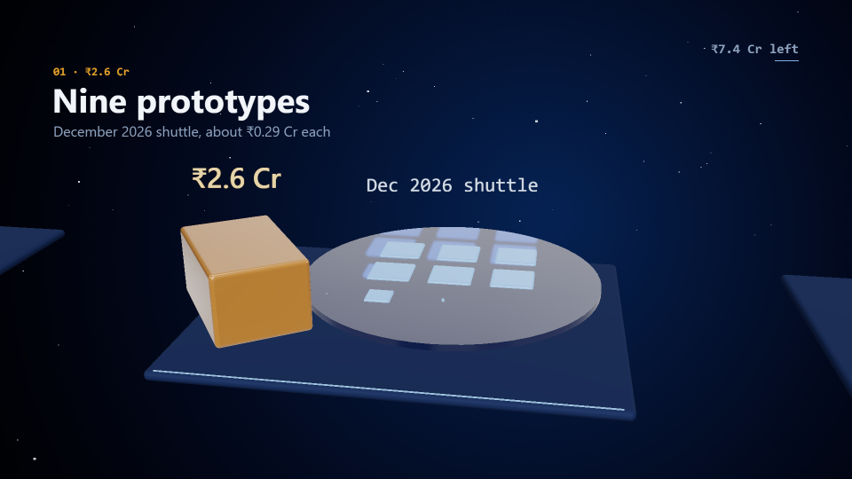

# Glass 3D

Glass-and-light 3D motion design rendered with Three.js on the GPU: frosted glass slabs and panes, one warm emissive
glass for the subject, environment reflections, a gentle bloom on small lights, drifting dust, and a slow camera that
travels through depth between stations. Captions stay 2D (through `DEFER`) in the reference layout: a small coloured mono
tag, a big bold title top-left, one subtitle line, and a mono counter top-right. Made with new-style.md from short-form
Three.js explainers (references kept local, never copied); recoloured to the DeepGrid navy.

## Measured (reference globe/glass demos vs ours, compare.mjs)

| what | reference | this style |
|---|---|---|
| ground | near-black / dark blue radial, `rgb(8,8,8)`–`rgb(8,24,56)` | navy radial `#1d3157` → `#111c33` → `#070b14` (site palette) |
| subject material | glassmorphic panes, liquid metal, glowing points | warm amber transmissive glass (`warm`: transmission 0.82, ior 1.5, amber attenuation) |
| supporting material | frosted panes, blue holographic lines | frosted glass (`glass`), matte navy floors (`floor`), lit dies (`die`), dark packages (`dark`) |
| light | soft key + environment, bloom on points | RoomEnvironment PMREM, one key light, UnrealBloom 0.32 / radius 0.45 / threshold 0.9 |
| accents | amber packet glows, light-blue lines | HDR glow (`g3Glow`): light-blue trails `[0.9,1.7,3.0]`, amber sparks `[3.2,1.7,0.35]` |
| type | bold sans title ~7 % of height, small mono step tag in colour | 76 px bold title (7 %), 26 px amber mono tag, 32 px subtitle, left x = 120 |
| camera | slow push / orbit through depth | eased key path (`smoothstep` between keys), perspective fov 32 |
| fps | 60 | 24 (the skill's grid); `ones: true` |

## Palette and meaning

- `G3PAL.ground #0b1220` the paper; floors `#13213b` matte with a thin light-blue front edge.
- **Amber is the subject** (money, the hero object): `warm` material, `#ffd28a` labels, amber spark. One meaning per piece.
- Light blue `#7fb0e6` is structure and motion: edges, trails, dies.
- Text `#f1f5f9`, secondary `#8fa3bf`, tag `#e3a12a`.

## Motion habits

- One continuous stage; beats are stations along +x and the camera glides between them on eased keys. **Start each glide on
  the beat's cue and arrive within ~1 s**, or the title names something the viewer can't see yet.
- Objects travel on low arcs that swing slightly **toward** the camera: with the camera above, an arc away from it rises
  on screen into the title band.
- A trail of 28 small HDR spheres behind a moving object reads as a streak; 12 larger ones read as dots.
- Landing: a 0.35 s flash on the object, never a growing sphere on the floor (it reads as a dome).
- Hold the camera still for a silence/turn beat; resume for the payoff.

## Frame checklist (on top of grammar/FRAME.md)

1. **One warm subject**; everything else cool glass or navy. No second warm colour.
2. **Floors are matte.** A clearcoat on a dark floor reflects the room at grazing angles and reads silver.
3. **Nothing 3D crosses the title band** (y < ~330 at 1080) or the footer line; check flying objects mid-flight.
4. **Labels never stack**: one 3D label per object, staggered heights in a row; station labels only during their beat.
5. **Rows fit the frame** with margin at the widest camera of that beat.
6. **The title matches what is in view** (camera arrived).
7. Bloom only on small lights and trails; no white flare on large faces.

## Kit API (`kit.js`)

- `g3Frame(build)`: clears the scene, calls `build(scene, cam)`, renders through the composer, draws onto `ctx`.
- `g3Look(pos, at)`; `g3Mesh(geo, mat, pos, rot, scale)`; geometry `g3Box(w,h,d,r)` (rounded), `g3Cyl`, `g3Cap`, `g3Sph`.
- Materials `g3Mat('glass'|'warm'|'floor'|'dark'|'die'|'light', tint?)`; `g3Glow(rgbHDR, opacity)` + `G3GLOW.blue/amber`.
- `g3Label(str, pos, { height, color, weight, mono })` (sprite); `g3Dust(key, n, box, t)`.
- 2D: `g3Title(tag, title, sub, { at, size })`, `g3Counter(str)`, `g3Foot(str)` (all through `DEFER`); `g3Spring(t, t0, {k, damp})`.
- Pieces set `TIMELINE.gpu = true`: export and review then launch Chromium with the GPU flags (tools/gpu.mjs) and print the
  renderer. On Windows that is ANGLE/D3D11; in WSL it falls back to software (correct, much slower). `still`/`tile`/
  `storyboard` use the default launch and still work.

## Do / don't

- **Do** cache geometry, materials and label textures by key (`g3Cache`); rebuild the scene graph every frame from `TT`.
- **Do** keep Three.js inside the kit: it is a bundled IIFE (`THREE` global) whose two URL strings are split/trimmed so
  `build.mjs`'s URL scan passes. Rebuild it with esbuild (`--bundle --format=iife --global-name=THREE`) from three's
  core plus EffectComposer, RenderPass, UnrealBloomPass, OutputPass, RoomEnvironment, RoundedBoxGeometry.
- **Don't** name piece helpers `camAt` (kit/morph.js defines it and loads later, silently replacing yours) — prefix them.
- **Don't** rely on 2D morph bridges; join beats with camera moves.

## Not matched

- The reference's holographic light-blue linework and dense HUD text; its 60 fps.
- Depth of field and haze.
- The format: a travelling camera fits no proven card (closest: F1, unproven); the F2 fixed-stage review checks do not apply.

## Proven on

`pieces/tranche-1` in the DeepGrid site repo (20 s, 16:9, 2026-10-16): review PASS (story arc 3/3, text, dead beats),
1.0 s silence before the loudest hit at the payoff, −14.4 LUFS, tile `deterministic: true`, exported on Intel UHD 630
via ANGLE/D3D11 (480 frames in 29 s). Open: true peak −0.8 dBFS vs the −1 target.
