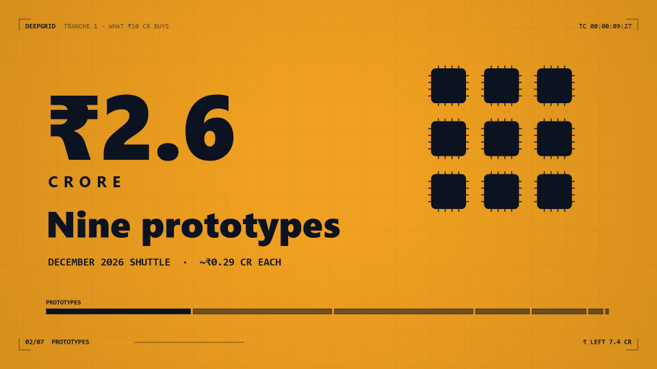

# Motion reel

Graphic motion design in the manner of a motion designer's showreel: full-bleed colour fields that cut on the line or
the beat, huge kinetic type that rises word by word from a masked baseline, rolling slot-counter numerals, eased bars and
glowing motion paths, and a crisp HUD frame (corner brackets, a live timecode, a section counter with progress, a
right-hand readout). One accent colour carries the meaning. 2D canvas only: fast, deterministic, no GPU. Made with
new-style.md after the owner judged 3D-primitive and line-art films "not professional"; studied from motion-reel
references (kept local, never copied), recoloured to the DeepGrid palette.

## Measured (reference reel vs ours)

| what | reference | this style |
|---|---|---|
| fields | black, orange, white, full bleed, hard cuts | navy `#0b1220`, amber `#f0a020`, white `#f4f6fa`; one field per line |
| headline type | heavy sans, 10–20 % of height, tracked caps for labels | 800 weight, 96–120 px (9–11 %); tracked caps 44–64 px |
| numerals | giant slot-roll counters (89 %) | `mrRoll`: 260–440 px, quart-out roll with a short streak |
| chrome | corner brackets, title, timecode, section n/N + progress | `mrHud`: same, plus a ₹ readout; drawn through DEFER at screen size |
| motion | expo/quart easing, staggered word reveals, motion paths with glowing heads | `mrWords` (expo, 0.06 s stagger), `mrPath`, `mrBar` |
| camera | mostly locked; occasional push | a 3.5 % push per shot (pieceCam) so held lines never read as stills |

## Palette and meaning

- Amber is the accent: money, the active item, the payoff. On an amber field the accent becomes ink.
- White fields are for a calm beat (the team, a timeline); navy is home.

## Motion habits

- Voice-led: cut ~0.25 s before each line; land each reveal on the word that names it (`VW(id, word)`).
- The peak needs the fastest cuts: break a list into full-frame cards cut on each item's word.
- Don't draw a word before its rise starts (the text check traces clipped text too).

## Frame checklist (on top of grammar/FRAME.md)

1. One idea per frame, set big: a numeral or a headline fills at least a third of the width.
2. Content stays inside x 160–1760 and y 160–900; the HUD owns the 56 px frame.
3. No dead half: if the right half is empty, the frame needs a visual there (grid of glyphs, timeline, bars).
4. The accent means one thing per piece.
5. Labels in mono caps, sentence-case headlines, no more than two type sizes besides the numeral.

## Kit API (`kit.js`)

`mrField(colour)`, `mrWords(str, x, y, size, {at, stagger, d, weight, color, track, mono, align})`, `mrRoll(value,
decimals, x, y, size, {at, d, from, prefix, suffix, color, track, align})`, `mrBar(x, y, w, h, colour, t0, d)`,
`mrPath(points, u, colour, {w, head})`, `mrChip(x, y, size, lit, colour, field)`, `mrHud({field, title, section, right})`,
easing `mrOut`, `mrExpo`, `mrInOut`, `mrK(t0, d)`; palette `MR`.

## Proven on

`pieces/tranche-1-reel` in the DeepGrid site repo (42 s, 16:9, 30 fps, Founder Voice narration, 2026-10-17): review
PASS — story arc 5/5, text 0 overlaps, dead beats 0, −14.8 LUFS, true peak −1.5 dBFS.
